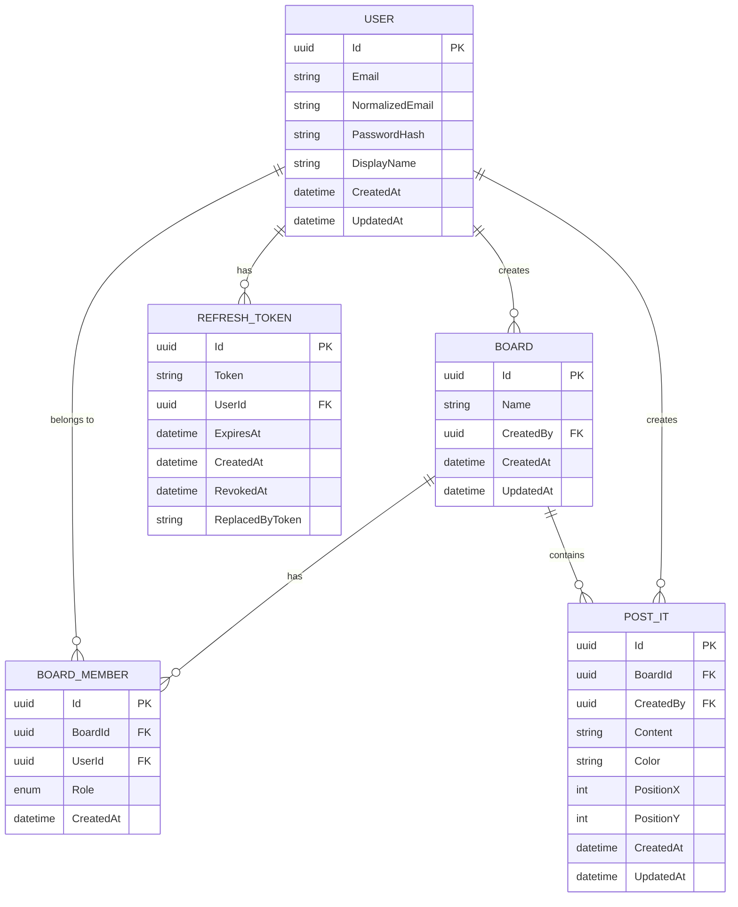
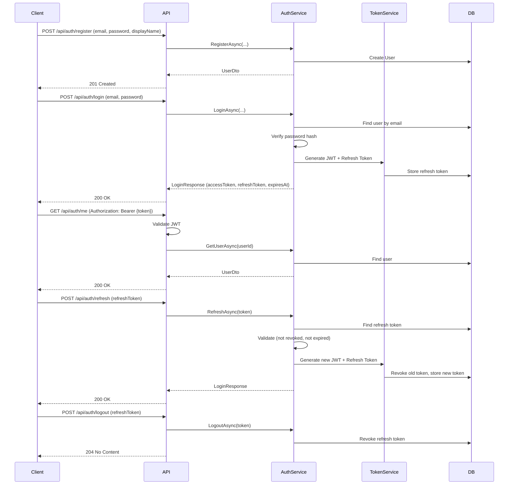
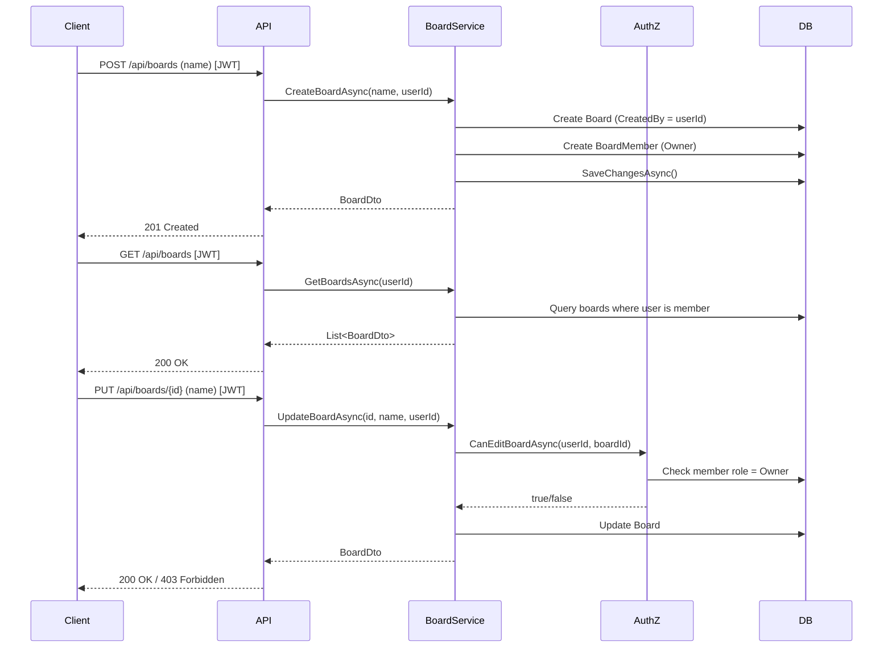
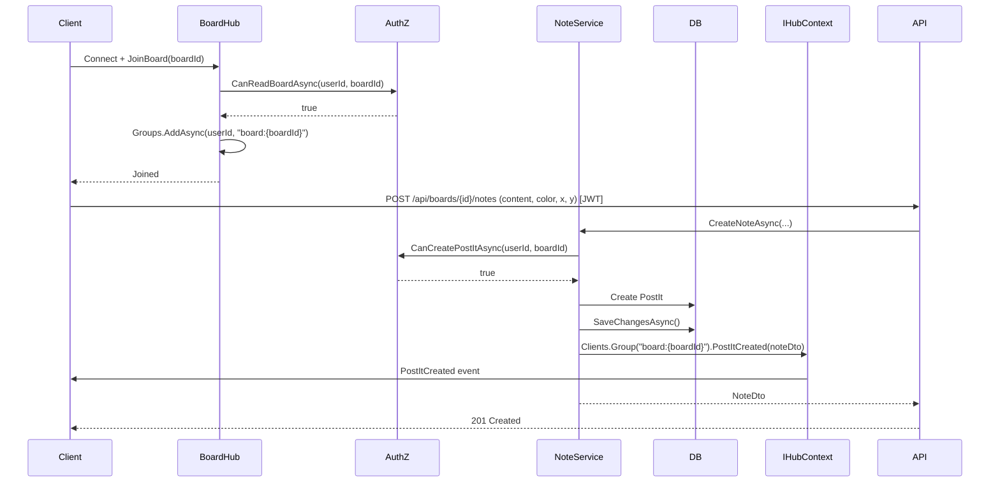

# PostIt Server — Architecture Documentation

## 1. Clean Architecture Layers

```mermaid
graph TD
    subgraph Api["PostIt.Api (Presentation Layer)"]
        Controllers["Controllers (Auth, Boards, Notes)"]
        Hubs["SignalR Hubs (BoardHub)"]
        Middleware["Middleware (Exception Handling, Logging)"]
    end

    subgraph Application["PostIt.Application (Business Logic Layer)"]
        Services["Services (Auth, Board, Member, Note)"]
        DTOs["DTOs (Request/Response)"]
        Interfaces["Interfaces (Repositories, Services)"]
        AuthZ["Authorization (BoardAuthorizationService)"]
    end

    subgraph Domain["PostIt.Domain (Core Domain Layer)"]
        Entities["Entities (User, Board, BoardMember, PostIt, RefreshToken)"]
        Enums["Enums (BoardMemberRole)"]
    end

    subgraph Infrastructure["PostIt.Infrastructure (Data Layer)"]
        DbContext["PostItDbContext (EF Core)"]
        Repositories["Repositories"]
        Identity["Password Hashing (Identity)"]
    end

    subgraph Database[(PostgreSQL)]
        Schema["Database Schema"]
    end

    Api --> Application
    Application --> Domain
    Infrastructure --> Application
    Infrastructure --> Domain
    Infrastructure --> Database
```

## 2. Domain Model



## 3. API Endpoints

### Authentication
```
POST /api/auth/register      → Register new user
POST /api/auth/login         → Login, returns JWT + refresh token
POST /api/auth/refresh       → Refresh tokens (rotates refresh token)
POST /api/auth/logout        → Revoke refresh token
GET  /api/auth/me            → Get current user
```

### Boards
```
GET    /api/boards           → List boards (member only)
POST   /api/boards           → Create board (becomes Owner)
GET    /api/boards/{id}      → Get board details
PUT    /api/boards/{id}      → Update board (Owner only)
DELETE /api/boards/{id}      → Delete board (Owner only)
```

### Board Members
```
GET    /api/boards/{id}/members           → List members
POST   /api/boards/{id}/members           → Add member (Owner only)
PUT    /api/boards/{id}/members/{userId}  → Update role (Owner only)
DELETE /api/boards/{id}/members/{userId}  → Remove member (Owner only)
```

### Notes (Post-its)
```
GET    /api/boards/{id}/notes     → List notes
POST   /api/boards/{id}/notes     → Create note (Owner/Editor)
PUT    /api/notes/{id}            → Update note (Owner/Editor)
DELETE /api/notes/{id}            → Delete note (Owner/Editor)
```

### Realtime
```
/hubs/boards  → SignalR hub for realtime collaboration
```

### Health
```
GET /health   → Health check (includes database)
```

## 4. Authentication Flow



## 5. Board CRUD Flow



## 6. SignalR Realtime Flow



## 7. Authorization Matrix

| Action | Owner | Editor | Viewer |
|--------|-------|--------|--------|
| Read Board | ✅ | ✅ | ✅ |
| Edit Board | ✅ | ❌ | ❌ |
| Create Post-it | ✅ | ✅ | ❌ |
| Edit Post-it | ✅ | ✅ | ❌ |
| Delete Post-it | ✅ | ✅ | ❌ |
| Manage Members | ✅ | ❌ | ❌ |

## 8. Project Structure

```
apps/server/
├── PostIt.sln
├── Directory.Build.props
├── .editorconfig
├── docker-compose.yml
├── README.md
├── ARCHITECTURE.md
├── src/
│   ├── PostIt.Api/
│   │   ├── Controllers/
│   │   │   ├── AuthController.cs
│   │   │   ├── BoardsController.cs
│   │   │   └── NotesController.cs
│   │   ├── Hubs/
│   │   │   └── BoardHub.cs
│   │   ├── Middleware/
│   │   │   └── ExceptionHandlingMiddleware.cs
│   │   ├── Services/
│   │   │   └── BoardNotificationService.cs
│   │   ├── Program.cs
│   │   └── appsettings*.json
│   ├── PostIt.Application/
│   │   ├── DTOs/
│   │   ├── Interfaces/
│   │   ├── Services/
│   │   └── DependencyInjection.cs
│   ├── PostIt.Domain/
│   │   └── Entities/
│   └── PostIt.Infrastructure/
│       ├── Persistence/
│       │   ├── PostItDbContext.cs
│       │   ├── Repositories/
│       │   └── Migrations/
│       └── DependencyInjection.cs
└── tests/
    ├── PostIt.UnitTests/
    └── PostIt.IntegrationTests/
```

## 9. Technology Stack

- **.NET 8** — Runtime and framework
- **ASP.NET Core Web API** — HTTP API
- **SignalR** — Realtime communication
- **Entity Framework Core 8** — ORM
- **PostgreSQL** — Primary database
- **Npgsql** — PostgreSQL driver for EF Core
- **JWT** — Authentication tokens
- **ASP.NET Core Identity** — Password hashing only
- **xUnit** — Testing framework
- **Testcontainers** — Integration test database (with SQLite fallback)
- **Swagger/OpenAPI** — API documentation
- **Serilog** — Structured logging
